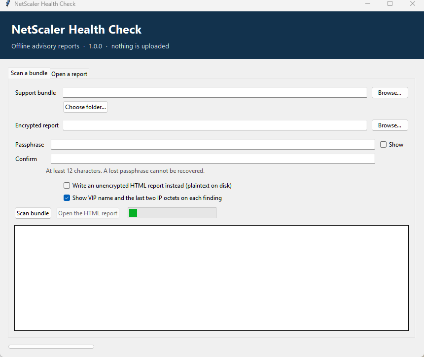
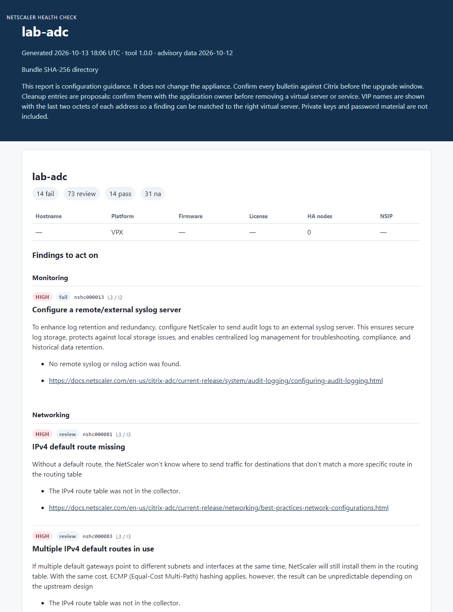

# NetScaler health check

Drop in a Citrix NetScaler ADC or Gateway support bundle. Get an encrypted report of failing checks, the current Citrix bulletin floors, and a cleanup list. The bundle is not uploaded, and the tool does not change the appliance.

Free to use. No purchase, account, or license file is required.

**[Download the Windows program](https://github.com/PacketPath01/NetScaler_Health_Check_v1/releases/latest)**

Python is not required. Double-click `NetScaler.Health.Check.exe`. The first launch takes a few seconds.



The report below is from a fictional appliance named `lab-adc`. It is not a customer system. Addresses are shown as the last two octets only.



The tool reads a `collector_*.tgz` (or a directory that contains `ns.conf` and `shell/showcmds.txt`) and compares it with:

- the automated checks in the NetScaler health-check definitions workbook
- deployment gaps that the workbook does not score on their own (certificate expiry, LDAPS certificate validation, SNMPv3 `noAuthNoPriv`, cleartext syslog, RPC left unencrypted on HA or GSLB, upgrade free space)
- a cleanup review of services, virtual servers, servers, and custom monitors that nothing in the saved configuration uses
- a routing review for down static routes, next hops that are not on a connected subnet, backends with no matching up route, and policy-based routes that are enabled but not applied
- extra hardening and operations checks: response headers, cookie flags, HTTP-to-HTTPS redirects, OCSP stapling, MFA, management exposure, certificate expiry monitoring, login rate limits, VMAC, default-route placement, HA sync, interface errors, VLAN layout, backups, appliance DNS, timezone, license headroom, packet-engine counters, crash-history collection, monitor timing, AppFlow, HTTP/2 and HTTP/3, audit-log hashing, and hybrid post-quantum key exchange
- published Citrix security bulletins through 12 October 2026, including the SAML bulletins CTX697174 and CTX697191

It does not change the appliance, upload the bundle, or include exploit instructions. The remediation for a bulletin is the fixed build named by Citrix. Confirm the bulletin on Citrix support before an upgrade window. Later builds supersede the floors shipped in `nshc/advisories.py`.

Do not commit support bundles, decrypted reports, or passphrases. Those files are ignored by git.

## Download

Use **[Releases](https://github.com/PacketPath01/NetScaler_Health_Check_v1/releases/latest)** and download `NetScaler.Health.Check.exe`. The other PC does not need Python. Double-click the file to open the window. The first launch unpacks into a temporary folder and takes a few seconds.

## Install

```powershell
cd netscaler-healthcheck
python -m pip install -r requirements.txt
```

Python 3.11 or newer is required.

## Desktop app

Double-click `nshc_gui.pyw`, or from PowerShell:

```powershell
python -m nshc.gui
```

Use **Add to Desktop and Start menu** inside the window to pin **NetScaler Health Check**. The window scans a bundle, encrypts the report, and opens the HTML findings in your browser. Leave **Show VIP name and the last two IP octets** checked when a finding needs to name the virtual server. The same passphrase rules apply. Delete the decrypted folder when you are finished.

## Command line

From PowerShell, the downloaded program also runs a scan or decrypt:

```powershell
& "C:\path\NetScaler Health Check.exe" scan C:\path\support.tgz --out C:\path\report.nshc --show-targets
& "C:\path\NetScaler Health Check.exe" decrypt C:\path\report.nshc --out C:\path\report-folder
```

## Rebuild the exe

From a checkout of this repository:

```powershell
python -m pip install pyinstaller
python -m PyInstaller --noconfirm --clean nshc.spec
Copy-Item ".\dist\NetScaler Health Check.exe" ".\release\" -Force
```

## Scan

```powershell
$env:NSHC_PASSPHRASE = "a long passphrase you can store safely"
python -m nshc scan C:\path\support.tgz --out C:\path\ns-healthcheck.nshc --show-targets
```

If `NSHC_PASSPHRASE` is not set, the tool prompts twice in the terminal. The passphrase must be at least 12 characters. There is no recovery if it is lost.

Decrypt when you need the HTML and JSON:

```powershell
python -m nshc decrypt C:\path\ns-healthcheck.nshc --out C:\path\ns-healthcheck
```

Delete the decrypted directory when you are finished. It is plaintext and contains hostnames, management addresses, and finding evidence.

`--plaintext` writes that HTML and JSON directly. Use it only on a protected workstation.

## Encryption

Reports are encrypted with AES-256-GCM. The passphrase is stretched with scrypt (N=32768, r=8, p=1). The GCM tag rejects a wrong passphrase and a modified file. The container starts with `NSHC1`.

The scanner also:

- reads the archive in memory and does not unpack it to disk
- refuses archive paths that contain `..` or start at the filesystem root
- does not copy private keys into the report; `.key`, `.pfx`, and `.p12` members are counted and skipped
- redacts `-encrypted` password blobs, community strings, and PEM private keys if they ever reach an evidence line
- grants the current user read/write on the report file without removing existing access

Support bundles themselves often contain `ns.conf`, certificates, and sometimes private keys. Keep the original `.tgz` as carefully as the report.

## Refresh the check wording

```powershell
python -m nshc import-checks C:\path\healthcheck.xlsx
```

That rewrites `nshc/data/checks.json`. Scoring uses the workbook likelihood and impact:

| Likelihood \ Impact | 1 | 2 | 3 |
| --- | --- | --- | --- |
| 1 | LOW | LOW | MEDIUM |
| 2 | LOW | MEDIUM | HIGH |
| 3 | MEDIUM | HIGH | HIGH |

Security bulletins use their own severity. An open critical bulletin is reported as `CRITICAL` even when the workbook lifecycle check is a pass, because 13.1 and 14.1 can be supported and still behind the current fixed build.

## Tests

```powershell
python -m unittest tests.test_nshc -q
```
